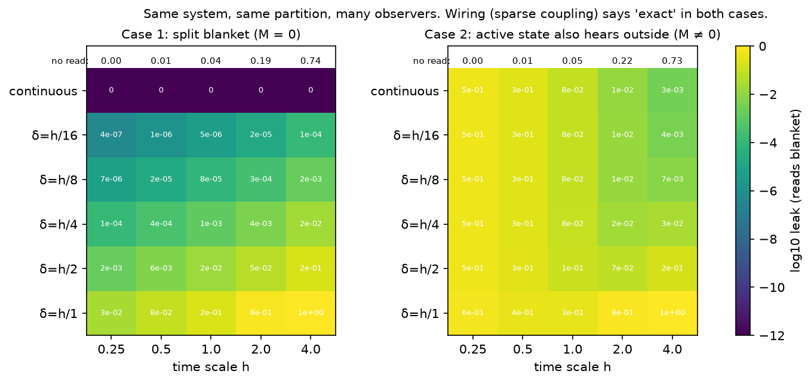

# Interface With Whom? Markov Blanket Claims Depend on the Observation Protocol

**Authors:** CK Hung, Emmy Team (Amoy Technology)  
**Date:** 22 October 2026  
**Version:** 1.0.1 (October 2026)  
**License:** CC BY 4.0 (code: MIT)  
**DOI:** https://doi.org/10.5281/zenodo.23524008 (all versions; version 1.0 is 10.5281/zenodo.23524009)  
**Code:** archive `fep-blanket-code-v1.0.zip`, published together with this paper (also at github.com/casualwriter/ifo-fep)  
**Companion technical note:** "Finite-Window Path Screening in Linear Diffusions: An Exact Condition and a Residual-Leak Formula" (version 1.0, published together with this paper). It is the evidence base of this paper, with the full proofs, numerical checks and disclosures. Section numbers marked "companion" refer to it.  

## Abstract

**We build on the free energy principle (FEP) of Friston and colleagues, which describes a Markov blanket as the interface between inside and outside. We offer one more point of view: screening conditions change with what is conditioned on (states, histories or paths), so a blanket claim is complete only when the observation protocol is stated. In short, an interface is an interface with someone.** In a linear stochastic system, "inside and outside are independent given the blanket" is not one statement. It changes with what is conditioned on (the blanket path or only its current state; a long history or a short one; the whole blanket or only its sensory part), with what is asked (paths or current states), with the start knowledge, and with the time scale. We give exact results for this, and a tool. Our aim is to share this point of view in a form that experts can test, correct and take further.

The point of view comes from a wider framework we are developing (IFO). We propose reading this as "a blanket is an interface with an observer", where an observer is a protocol: what it pushes, reads and conditions on. This is an interpretation. It has the same mathematical content as the rival reading in which the system has several observer-independent properties and different protocols measure different ones; no result here separates the two (Section 1.4). Every theorem below holds under either reading.

Results, all for linear stochastic systems:
- **One system, several answers.** In one 8-state system, sparse coupling accepts the partition, while a reader who pushes the inside and reads the blanket continuously still learns about the push from the outside. Its leak score (a ratio of conditional mutual informations, Section 4; value at time scale $h = 0.5$) is 0.26.
- **One condition for two idealised readers.** Given no direct inside–outside coupling, a reader that reads whole paths in the long-history limit, and a reader that reads only the past and asks about current states, both see exact screening if and only if $M = A_{BI}^{\top} D_B^{-1} A_{BE} = 0$. (For a stationary reader of the whole time line, the spectral form of this condition is known; Fasen-Hartmann & Schenk, 2025.) Screening can hold when no blanket exists in the stationary density, which is a different (snapshot) reading. These readers are mathematical idealisations; we do not claim that a physical interior has this information. In our networks a reader of the sensory states alone saw a leak even when $M = 0$ (30 of 30), as d-separation predicts: the path $I \to A \to E$ stays open.
- **Screening is not encoding.** The FEP asks one boundary to do two jobs: to separate inside from outside (screening), and to let the inside's expected state determine the expected outside (encoding, through the synchronisation map). In linear systems they need different conditions: $M = 0$ for screening, a kernel condition for encoding. Between a snapshot encoding and causal screening, neither implies the other in our examples. For the causal reader we found no exact map in 90 networks; the reverse causal non-implication is open.
- **Exact screening is yes or no; leak scores are graded.** We define several leak scores. They are different diagnostics, not degrees of one property, and some depend on units.
- **Layered systems.** In nearest-neighbour layered systems with independent noise, every two-layer shell screens exactly under the readers above, and a one-layer shell in which a state hears both sides generically does not. Several nested shells can screen at once, and an observer outside the shell can use only those that put its access outside. When the core gains a direct link to the inner shell, the inner candidate stops screening (leak 0 → 0.29) and the outer candidate still screens. We give no principle for selecting one shell as "the" particle.
- **A shared core.** Given no direct inside–outside coupling, all observers who know the start, push the whole inside once, read the whole outside and read the blanket continuously agree on whether the leak is zero at every time scale and push size: the condition is $M = 0$. (A zero at one single time scale can occur by accident when $M \neq 0$.)

We also give a real case: for brain blankets read off fMRI connectivity, the present estimator and calibration cannot decide whether the leak differs from zero. We state plainly what is not yet proven, and we invite experts to build on the view.

## 1. The idea

### 1.1 What we build on, and what we add
The FEP describes a Markov blanket as the interface between internal and external states. We adopt this description and study its exact conditions in continuous time. The FEP literature already holds many of the ingredients we use: nested blankets (blankets of blankets; Friston et al., 2021), particles whose blankets wander and change (Friston et al., 2023), and instrumentalist readings of blankets (Bruineberg et al., 2022). What we add is one way to put these together: ask first, "an interface with whom?". The table compares two ways of thinking. It does not say that any author holds the left column.

| | One way of thinking: the blanket as a fixed set of states in the system (a reading that stationary-density constructions such as Friston, 2019, can suggest, though the FEP literature also contains other readings) | This paper (interface with an observer, as an interpretation) | Support |
|---|---|---|---|
| What it is | a set of states that exists in the system, waiting to be found | what appears where the inside meets **a given outside** (an observer) | §2, §2b, §4 |
| How many | one: "the" particle | **many**: each outside meets the system through its own interface | §2b, §4.2 |
| Yes or no? | exact or not | exact screening is yes or no; **leak scores are graded** (several different diagnostics, §4) | §3, Fig. 1 |
| Time | static, built on a stationary state | **changing**: with time scale, with history, and as the system grows | §2 (A2), §2b, §4.1 |
| Objectivity | independent of observers | **shared by aligned observers** | §4.3 |

**Many outsides.** We use "observer" for a specified push, read and conditioning protocol; different parts of a system's surroundings can motivate different protocols. Most formal treatments write the "outside" of a Markov blanket as one set: the external states. In practice a system meets many outsides:
- different parts of its environment;
- the experimenter who stimulates and records it;
- the algorithm that detects its boundary;
- the particle's own interior, looking out.

Each of these may push, read and condition differently. They can then disagree about whether a given partition screens, and they can also agree. In our mathematics, an outside acts as an observer in a precise sense: what it can push, what it can read, and what it conditions on (Section 3 of the companion note). We use "observer" only in that sense: a protocol, that is, what is pushed, what is read, what is conditioned on, and what is asked. We make no claim about how a physical observer carries out the conditioning. A part of the environment counts as an observer when its coupling to the system can be described this way. The question "where is the blanket?" therefore needs a second question: **interface with whom?**

We describe an outside — an observer — by its measurement protocol:
- **push set:** what it can push;
- **read set:** what it can read;
- **reading:** how often it reads the blanket (never, every $\delta$, or continuously);
- **start knowledge:** what it knows about the start;
- **target:** whether it asks about current states or whole paths;
- **time scale:** the time scale $h$ it works on;
- **units:** the units it measures in.

All observers ask the same kind of question: does a change on one side alter what I would predict about the other side, beyond what I can see of the interface? They differ in access and in target.

### 1.2 Relative, not subjective
"Observer-relative" does not mean subjective or arbitrary:
- **Exact for a stated observer.** Once the observer is stated, its blanket and its leak follow exactly from the system's dynamics (here $A$ and $D$), not from anyone's opinion.
- **Shared by aligned observers.** Observers who share an interface find the same blanket. That shared part is what we call objective.
- **The dynamics are observer-free.** The path measure of the system is observer-free. What depends on the observer is which property of it is the blanket.

Velocity is the familiar case: it is relative to a frame, yet not subjective.

### 1.3 Four claims
- **C1 (interface with an observer; interpretation).** Whether a partition screens, and how large the leak scores are, depends on the system and on the protocol of the outside that meets it.
- **C2 (many).** In systems with enough structure (for example the layered systems of Section 2b), several nested blankets can screen at once, and which of them a given outside can use depends on where it stands. In generic unstructured networks, a non-trivial exact blanket may not exist at all. As a hypothesis, the FEP's nesting of blankets across scales may be the same phenomenon seen by observers at different scales (Section 7).
- **C3 (leak scores change).** For a given observer, leak scores are defined. They change with the observer's time scale and history, and with the system's own structure. Exact screening is yes or no.
- **C4 (shared core).** For a stated class of observers (Section 4.3) there is a fact on which all of them agree: whether the leak is zero at every time scale. This is the part of a blanket claim that does not depend on which observer in the class makes it.

### 1.4 Status of the claims
| Kind | What | Where |
|---|---|---|
| **Theorems** (linear diffusions; proofs in the companion) | **Theorem A1:** exact path screening iff wiring cut, $M = 0$ and the start condition. **Theorem A2:** with a long history the start is forgotten. **Theorem A3:** a causal reader needs the same $M = 0$. **Theorem B:** the invariant core for continuous readers. **Lemma (2b):** two-layer shells have $M = 0$ for all weights. Expansions for total-effect observers (§4.1, §4.2) | §2, §2b, §4 |
| **Score designs** (our choices, not facts) | leak scores for each observer: total-effect share, conditional push-information ratio, residual leak | §4, companion §2.3 |
| **Numerical findings** (linear, random networks; not theorems) | screening and encoding need different conditions, and neither implies the other (by example); in our networks the interior needed to read its own active states; time-scale rankings; critical slowing | §2, §4 |
| **Interpretation** [M] | Calling wiring cuts, snapshot independence, path independence and total-effect shares "the blankets seen by different observers" is our unifying reading. It is not a theorem. The theorems hold whether or not one accepts it | §1, §3 |
| **Open** | a principle that selects one shell as "the" particle; a transformation law between observers; nonlinear systems; certified real-data blankets; when encoding holds | §7 |

**A rival reading.** One can also say: the system has several observer-independent properties (no direct coupling, snapshot independence, path independence, attenuation of pushes), and different protocols measure different ones. This has the same mathematical content as our reading, and no result here tells the two apart. We use the observer reading because of what it leads to:
- it says in advance that "where is *the* blanket?" has no answer until the protocol is stated, and the many-shell result (Section 2b) shows this even within one class of observers;
- it asks for a transformation law between protocols (Section 7), which the rival reading does not suggest;
- it puts the ideal blanket-history reader next to the experimenter's and the algorithm's readings, so that their conditions can be compared (Section 2).
This is a choice of framing, judged by what it helps to find. It is not a finding.

**Origin.** The claims come from a broader framework developed by the authors (IFO). In it, boundaries are interfaces defined by how they are met, and objectivity is agreement among observers. Nothing below depends on that framework. Every claim is stated and supported in ordinary terms.

## 2. An ideal blanket-history reader: what its blanket must satisfy

A natural question about C1 is this: "The blanket is fixed by the flow and its density. External observers are irrelevant; the only observer that matters is the particle itself."

We agree that the particle matters most. We ask what the blanket must satisfy for an ideal reader that has the information in the blanket. We call it the ideal blanket-history reader. Whether a physical interior has this information is a separate question that needs its own recoverability condition (a link between the interior's state and the blanket's history); we do not show it.

**The ideal blanket-history reader.** An ideal reader that has the information in the blanket has the following protocol. (We use the interior's role only as the motivation.)
- **reading.** It follows the blanket, since it is driven by it. We idealise this as the information in the blanket path (its filtration). This is an idealisation of what is available to the interior, not a claim that the interior computes anything. Theorems A1 and A2 condition on the blanket during the interval asked about; Theorem A3 needs only the past.
- **action.** It acts on the outside only through active states.
- **target.** What matters is paths: its own trajectory, given the blanket's trajectory.
- **history.** A living particle has been reading its blanket for a long time before any time we call "0".

Screening for this reading is the FEP's conditional independence of inside and outside given the blanket. The FEP also claims that internal states encode beliefs about external states. We do not derive that claim, and we show below that screening does not give it.

**The readers in this paper** (all for linear diffusions with block-diagonal noise; the noise structure is essential: with correlated noise between the groups the condition is no longer $M$):

| Reader | Conditions on | Asks about | Exact screening iff | Where |
|---|---|---|---|---|
| Wiring criterion | the drift matrix only | — | $A_{IE} = A_{EI} = 0$ (a sparsity test, not screening) | §4 |
| Snapshot reader | the current blanket state, stationary density | current states | zero $I$–$E$ block of the stationary precision | §4.1(d) |
| Finite-history path reader | blanket path on $[0,h]$, start known or random | paths on $[0,h]$ | wiring cut, $M = 0$, start condition (A1) | §2 |
| Long-history path reader | blanket path on $[-L,h]$, $L \to \infty$ | paths on $[0,h]$ | wiring cut and $M = 0$ (A2) | §2 |
| Whole-line reader | blanket path on the whole time line, stationary | paths on the whole time line | zero inverse-spectral $I$–$E$ block: $K + i\omega(C' - G) = 0$ for all $\omega$ ($K$, $C'$, $G$ as in companion §3.1, Step 2); with a wiring cut, iff $M = 0$; without it, a cancellation can also screen (Fasen-Hartmann & Schenk, 2025) | §8 |
| Causal reader | past of the whole blanket, $(-\infty,t]$ | current states | $M = 0$, given a wiring cut (A3) | §2 |
| Sensory-only causal reader | past of the sensory states | current states | not shown; leaked in all tested networks | §2 |
| Push reader | start known, one push on all of $I$, blanket read every $\delta$ or continuously | $x_E(h)$ | residual leak zero at all $h$ iff $M = 0$, given a wiring cut (B) | §4.3 |
| Total-effect reader | start known, one push, blanket not read | $x_E(h)$ | not exact for $h > 0$ when $I$ reaches $E$ | §4.1(c) |

**Theorem A (the ideal blanket-history reader; linear diffusions).** Assume noise independent across $I$, $B$ and $E$, and positive on each. This assumption is essential, not incidental: with correlated noise between the groups, the condition is no longer $M$.

*(A1) Finite history.* For an observer whose record starts at time 0, internal and external paths on $[0,h]$ are conditionally independent given the blanket path on $[0,h]$ if and only if:
1. **wiring cut:** there is no direct coupling between $I$ and $E$;
2. **no collider at the blanket:**
$$
M = A_{BI}^{\top} D_B^{-1} A_{BE} = 0 ;
$$
3. **start condition:** $x_E(0) \perp x_I(0) \mid x_B(0)$.

Conditions 1 and 2 are necessary whether or not the start is known (when the start is random, for a start law with a positive density; a known start is a point mass and is treated by Proposition 1 directly); given them, condition 3 is necessary and sufficient (it holds trivially when the start is known).

*(A2) Long history: the particle.* Suppose the observer has also read the blanket on $[-L, 0]$, the process is stationary and stable, and conditions 1 and 2 hold. Then the dependence between the paths on $[0,h]$, given the blanket on $[-L,h]$, equals the dependence between the start states given the blanket, and decays to zero as $L \to \infty$ (stationary Gaussian start). If condition 2 fails, it does not decay.

*(A3) A causal reader.* Suppose condition 1 holds, $A$ is stable and the process is stationary. An observer that at time $t$ has read only the past of the whole blanket (sensory and active states), $(-\infty, t]$, finds the current internal and external states conditionally independent if and only if $M = 0$.

So for an ideal reader with a wiring cut, in the long-history limit, **the criterion is $M = 0$**, whether it reads paths or reads causally; at a finite history $L$ the remaining dependence is exponentially small in $L$, with an unknown constant; in our checks the asymptotic rate was reached only by $L \approx 120$ time units, about 2.4 e-folds of the slowest rate (companion M13d), so exponentially small need not mean negligible at modest $L$. Condition 3 is not needed in this limit. For the causal reader of current states, no future readings are needed either. (For the finite-history path reader the wiring cut is necessary (Proposition 1). In the long-history limit, the dependence for $M \neq 0$ has an $L$-independent positive lower bound (companion §3.2b). For the causal reader we assume the cut.) All statements are for Gaussian (linear-diffusion) systems, where conditional independence is a zero cross-covariance or cross-precision block.

*Proof.*
- **(A1):** companion note, Proposition 1 (path likelihood; Cameron–Martin argument for necessity) and §3.2 (start law).
- **(A2):** companion Proposition 1b. Outline of the proof:
  1. Detectability: with a wiring cut, any mode of the stacked (interior, exterior) pair that the blanket cannot see is an eigenmode of the whole system. The whole system is stable, so the pair is detectable through the blanket even if the interior alone is unstable. (The wiring cut is what lets the block drift of the pair act as the full drift on such a mode.)
  2. The filtering Riccati equation therefore converges to its unique stabilising solution. With $M = 0$, that solution is block-diagonal, so the inside–outside cross-covariance decays exponentially.
  3. Later readings add only one-sided factors. By the chain rule, the dependence between the paths therefore equals the dependence between the start states given the blanket, which decays with this cross term.
  - With $M \neq 0$, the dependence is at least that of the paths given the state at time 0 and the blanket on $[0,h]$. This does not depend on $L$, and it is positive by A1.
- **(A3), proof sketch:** companion Proposition 1c. In the stationary filter, the inside–outside block of the Riccati equation, with that block of the solution set to zero, reads $-P_I M P_E = 0$. So a zero cross block forces $M = 0$, because $P_I$ and $P_E$ are positive definite (positive noise on $I$ and $E$, stable closed loop). The converse is step 2 above.
- **Rate of forgetting.** Asymptotically, the cross-covariance decays at the **sum** of the decay rates of the inside and the outside, both seen through the blanket. The mathematical statement is the rate bound in terms of the closed-loop matrices $C_I$ and $C_E$ (companion §3.2b). Slow forgetting needs a slow closed-loop mode on both sides that also carries the initial cross-dependence; their existence alone is not enough. An example is the phone number of Virgo et al. (2022): a number kept in memory and also on a note in a box. A prediction that one hidden side would suffice failed; this is disclosed in companion §3.2b.

*Check.* In the discrete-time model class of Section 6 (stationary start, 100 models per case; prediction fixed before the run), the median path dependence in nats for $L$ = 0, 2, 4, 8, 16 was:

| Case | $L$ = 0 | 2 | 4 | 8 | 16 |
|---|---|---|---|---|---|
| Split blanket ($M = 0$) | 0.0048 | $1.2\times10^{-8}$ | $8\times10^{-14}$ | 0 | 0 |
| Blanket state hears both sides ($M \neq 0$) | 0.041 | 0.034 | 0.034 | 0.034 | 0.034 |

In continuous time (companion §3.2b), the same forgetting holds when the interior alone is unstable (30 networks; dependence below $10^{-13}$ of its start value after $L$ = 40). For A3 (companion check M17, 30 split and 30 collider networks): with $M = 0$ the causal reader's dependence is below $2\times10^{-16}$; with $M \neq 0$ it is at least $3.8\times10^{-4}$ nats.

**A3 uses the active states.** The causal reader of A3 reads the whole blanket. A reader of the sensory states only must estimate the active states, which carry the interior's influence to the outside ($I \to A \to E$) and are not read. In 30 split networks ($M = 0$) its dependence was above $10^{-4}$ nats in all (median 0.015; companion check M17c, prediction fixed before the run). This is what d-separation predicts: with the active states outside the conditioning set, the path $I \to A \to E$ is open. In the random split networks tested here, the reader needed the active-state path. The 30 of 30 is a numerical confirmation, not a discovery about physical interiors; special systems may screen with sensory access alone.

**Screening is not encoding.** The FEP says that the expected internal state given the blanket, $\eta$, determines the expected external state, $\mu$, through a map $\mu = \sigma(\eta)$ (the synchronisation map). In linear systems such a map exists if and only if $\mu$ is linear in $\eta$. Let $R^2$ be the share of the total variance of $\mu$ that is linear in $\eta$; the map exists if and only if $R^2 = 1$ (an invariant statement; the kernel condition is proved). Values below 1 depend on the scaling of the components of $\mu$ (here noise units), so $R^2$ is a diagnostic, not a calibrated degree of encoding, and the values below are numerical (companion §3.2d, checks M17b and M17c, predictions fixed before the runs):

| Networks | Blanket read at one time | Blanket read causally, long history |
|---|---|---|
| Control: split, blanket no larger than the interior | $R^2 = 1$ in all (map exists) | — |
| Collider ($M \neq 0$), blanket no larger than the interior, 30 | map exists in 29 (the exception fails the kernel condition) | fails in all; median 0.71, max 0.993 (post hoc) |
| Split blanket ($M = 0$), 30 | map fails in all; median $R^2$ 0.80 | fails in all; median 0.55 |
| Collider ($M \neq 0$), 30 | fails in all; median 0.73 | fails in all; median 0.51 |

- **Two conditions, not one.** Screening needs $M = 0$. Encoding needs a different condition: in the snapshot case, every direction of the blanket that the inside's expectation ignores must also be ignored by the outside's expectation (a kernel condition; companion §3.2d). Neither condition implies the other across protocols: split networks screen under causal or path conditioning without a snapshot map, and small-blanket collider networks admit a snapshot map while leaking under causal conditioning.
- **Dimension, not $M$, drove snapshot encoding in our samples.** With blanket no larger than the interior ($|B| = |I| = 2$), the snapshot map existed in all 30 split control networks and 29 of 30 collider networks. With $|B| = 4 > |I| = 2$, it existed in 0 of 30 in both classes. So the snapshot dissociation tracks the kernel condition through the blanket dimension, independently of $M$ (companion §3.2d). For one fixed reader we have shown only one direction of non-implication: screening without encoding.
- **The causal reader never encoded exactly.** In the causal reading we found no exact map in any of 90 networks, including the 30 with $|B| = |I|$ (companion check M17d, post hoc). We conjecture that exact causal encoding is non-generic: the reader's estimate of the two sides generically has full rank. $R^2$ is a scale-dependent diagnostic of how far from exact; we do not treat it as a calibrated degree.
- In these samples the causal long-history reader had a lower median $R^2$ than the snapshot reader (0.55 against 0.80 for split networks; the units are fixed noise units, and the two readers differ in more than history length). We have not tested why.
- So the step from "the blanket screens" to "the interior encodes the outside" needs its own condition. These are numerical findings in random linear networks, not theorems.
- **Why this matters for the FEP.** The blanket is asked to be both a wall and a window. Our results say these are two properties with two conditions. A particle can have one without the other, so a claim that a system infers its world needs both to be checked.
- **What we call "exact".** By definition a Markov blanket is a screening property (Pearl, 2009). In this paper "exact blanket" means exact screening for the stated reader, and no more. The FEP's inferential role is the second job; we report it separately.

**What this shows.**
- **Not sparse coupling.** That is the wiring criterion, which accepts partitions with $M \neq 0$ (Section 5). It does not certify screening.
- **Not stationary conditional independence.** That is the snapshot observer, which looks at one time without history.
  - In our split models the stationary density has no snapshot blanket, which is why the start leak at $L = 0$ is positive.
  - Yet in the long-history limit the blanket screens exactly for the ideal blanket-history reader.
  - So the failure of stationary blankets out of equilibrium (Aguilera et al., 2022) is real, but it concerns the snapshot reading. It is not repaired for a physical particle by this result: a particle that interacts through its instantaneous state is still described by the stationary density. And $M = 0$ is itself a structural condition that generic sparse networks do not meet.
- **What the ideal reader needs:** a wiring cut and $M = 0$, for paths with a long history and for current states read causally.
  - This supports the history-based formulation proposed by Virgo, Rosas & Biehl (2022).
  - It gives the exact condition for linear diffusions, and the condition is checkable.
- **Scope.** Linear diffusions with state-independent noise. For nonlinear systems no analogue of $M$ is known (Section 7).

**What is already known.**
- Sufficiency of a split blanket — sensory states driven by the outside, active states driven by the inside, independent noise — is stated in the path-integral FEP (Friston et al., 2023, p. 10).
- The discrete-time result for current states given the sensorimotor history, and the remark that the start dependence fades for ergodic systems, are in Virgo, Rosas & Biehl (2022).

**What is added here.**
- Necessity.
- The noise weighting: correlated sensory–active noise can break screening even when the wiring is split (generically it does).
- Path level instead of current states.
- The two regimes: finite history needs the start condition; long history does not.
- The causal reader of current states: no future readings are needed.
- The separation of screening from encoding.
- The size of the leak when $M \neq 0$.
- The reading that ties them together: these are the conditions for **one particular protocol**, an ideal reader with access to the whole blanket history.

## 2b. Many outsides, many blankets; blankets that move

**The system.** Take a layered ("onion") system: a core $L_0$, then layers $L_1, L_2, L_3, L_4$. Each state interacts only within its layer and with the adjacent layers, and the noise is independent.

**Lemma (thickness gives the split).** Take the inside to be the inner layers and the outside to be the outer layers.
1. **One layer.** A blanket of one layer, $B = L_k$, has $M \neq 0$ for generic weights when some of its states hear both the inner and the outer side. So it leaks for the full-push, full-read observer of Theorem B (positive except at isolated time scales).
2. **Two layers.** A blanket of two adjacent layers, $B = L_k \cup L_{k+1}$, has a wiring cut and $M = 0$ for **all** weights (with diagonal blanket noise). It is exact for continuous readers who know the start, or whose start law factorises given the blanket's start, or in the long-history limit (Theorem A2; exponentially close at a finite history).

*Proof.*
- **One layer.** Suppose some state of $L_k$ is driven by $L_{k-1}$ (inside) and by $L_{k+1}$ (outside). Then $M = \sum_{b \in L_k} d_b^{-1} A_{bI}^{\top} A_{bE}$ contains a non-zero term, and it vanishes only on a measure-zero set of weights.
- **Two layers.** The inner layer $L_k$ is driven only by $L_{k-1}$ (inside) and by $B$; the outer layer $L_{k+1}$ only by $L_{k+2}$ (outside) and by $B$. No blanket state hears both sides, so $M = 0$. There is no direct inside–outside edge, so this is also a wiring cut. Theorems A1 and A2 then apply (and Theorem B for the push observer). $\square$

**Reading (an analogy, not part of the lemma).** The inner face hears only the inside and the blanket; the outer face hears only the outside and the blanket. This matches the FEP's partition into active and sensory states by who influences whom. In layered systems with nearest-neighbour coupling, a one-face boundary in which states hear both sides generically cannot screen. In general graphs this need not hold: one layer can contain separate sensory-like and active-like states, weights can cancel, and links that skip a layer or correlated noise can break a two-layer shell (companion §5.6). Whether any of this bears on real boundaries such as membranes is a speculation we do not test. The lemma needs a one-layer blanket in which some state has edges to both sides; sparse networks can miss this, which is why 4% of our networks did not leak.

**Observation C (several nested shells screen; an observer can use only those that exclude its access).** In the layered system, consider observers that push and read one layer, and that also read the candidate blanket continuously. Only the sufficiency direction of Theorem A1 is used: with a wiring cut and $M = 0$, the blanket is exact for a push at time 0 on the inside (or the blanket) and a read of the outside (or the blanket), by an observer with the start knowledge of the Lemma.
- **Exactness does not depend on where the observer stands.** Every two-layer shell, and every thicker shell, is exact for the continuous readers named in the Lemma.
- **Position does decide which shells are blankets for the observer.** The observer must lie outside the blanket.
  - **The near observer** (pushes the core $L_0$, reads $L_3$; companion §5.6) meets one two-layer shell: $L_1 \cup L_2$, with $L_0$ inside.
  - **The far observer** (access to $L_4$) meets two nested ones: $L_1 \cup L_2$ around $L_0$, and $L_2 \cup L_3$ around $L_0 \cup L_1$.
  - Thicker shells, such as $L_1 \cup L_2 \cup L_3$ for the far observer, are also exact.

The result is simple. Its point is that "the blanket of this system" is not unique even within one observer class: an outside meets the exact shells that lie between it and the core. The theorem shows that several valid partitions exist; it gives no principle that selects one of them as "the" particle (open, Section 7). **Hypothesis:** the FEP's nesting of blankets across scales, built by coarse-graining, is the cross-scale form of the same fact. This is open (Section 7).

**Blankets move when the system changes.** Let the core grow a direct path, of strength $\varepsilon$, to the outer layer of the inner shell ($L_0 \to L_2$).
- The inner blanket $L_1 \cup L_2$ then has a layer that hears both sides, so $M \neq 0$ and it starts to leak.
- The outer blanket $L_2 \cup L_3$ is untouched, and stays exact.
- For the far observer, the innermost two-layer shell that still screens is then $L_2 \cup L_3$. This is a change of a system parameter, not of the observer, and not growth in time; no unique particle boundary is selected.

**Checks** (50 random layered networks; predictions fixed in the script before the run):

| Check | Prediction | Result |
|---|---|---|
| One-layer blanket leaks | ≥ 95% of networks | 96% (median leak 0.13) |
| Two-layer blankets: $M$ and leak | exactly 0 in all networks | 0 and 0 in all |
| Near observer's two-layer exact blankets | only $L_1 \cup L_2$ | as predicted |
| Far observer's two-layer exact blankets | $L_1 \cup L_2$ and $L_2 \cup L_3$, nested | as predicted |
| Inner blanket leak as the shortcut grows ($\varepsilon$ = 0, 0.1, 0.2, 0.3) | rises; slope in $\log\varepsilon$ in [1.6, 2.4] | 0, 0.041, 0.14, 0.29; slope 1.77 |
| Outer blanket leak under the shortcut | stays 0 | 0 |

One network in 50 had no causal route from the core to the outside, so its score was undefined and it was excluded. The code was fixed after the first run to report such networks instead of letting them corrupt the medians.

## 3. One way of looking at several open problems

| Open problem in the FEP literature | Under the relation view | Section |
|---|---|---|
| "Blankets of blankets" (nested particles) | At one scale, an outside meets the exact shells that lie between it and the core, so nesting is natural. As a hypothesis, cross-scale nesting is the same fact seen by observers at different scales. | 2b, 7 |
| Many partitions qualify; which one is "the" particle? | Different observers pick different partitions, but this does not select one: several exact shells exist even within one class (Section 2b). For the particle, the relevant class is its own reading; a selection principle is open. | 2, 2b, 7 |
| Exact blankets are rare out of equilibrium (Aguilera et al., 2022) | That result is about the snapshot reading (one time, no history). In linear diffusions with a wiring cut and $M = 0$, an ideal blanket-history reader sees exact screening in the long-history limit even when no snapshot blanket exists. ($M = 0$ is not generic.) | 2, 4.1(d) |
| Do internal states encode the outside? | A separate question from screening, with its own condition; in our linear checks the synchronisation map failed whenever the blanket was larger than the interior, whether or not the blanket was exact. | 2 |
| Independence fails given the current blanket state, but holds given its history (Virgo et al., 2022) | Observers who ask about current states differ from those who ask about paths, and knowing the start matters for paths. | 4.1(a, b) |
| Sparse coupling and slow-mode coarse-graining disagree | The fast and slow limits of one of our scores rank partitions like these two methods. This is a heuristic link, not a derivation of adiabatic reduction. | 4.2 |
| Detection methods give method-dependent answers | A method is an observer, so its claims hold for the class it implies. | 6 |
| A living boundary seems to appear, move and vanish | Two causes, both computable. The observer changes: near a critical point a blanket fades for slow observers and stays exact for those who read it. Or the system grows: a new inner path breaks the inner blanket, while an outer one stays exact. | 4.1(e), 2b |

## 4. Mathematical support (linear stochastic systems)

**Setting and status.**
- System: $dx = Ax\,dt + D^{1/2}dW$, with $A$ stable and $D$ block-diagonal over $(I, B, E)$.
- The proofs are in the companion note.
- "Checked" means exact computation in random networks of 6–12 states. It does not mean real data.

**Scores** (our designs; definitions in companion §2.3). A push $u \sim N(0, \sigma_u^2 I)$ acts on all internal states at time 0; the observer reads all external states at time $h$.
- **Wiring criterion:** accepts the partition if and only if $A_{IE} = A_{EI} = 0$. Yes or no. It is a sparsity criterion, not a screening statement.
- **Total-effect share** (observer that does not read the blanket): with $R = e^{Ah}$, $\ell_{I\to E} = \sum_{e,i}R_{ei}^2 / (\sum_{b,i}R_{bi}^2 + \sum_{e,i}R_{ei}^2)$. A share in $[0,1]$; it depends on units. The score used for ranking partitions is $\rho(h) = 1 - \max(\ell_{I\to E}(h), \ell_{E\to I}(h))$; $\rho^c$ is the same with the residual leak.
- **Conditional push-information ratio, CPIR** (observer that knows the start and reads the blanket every $\delta$): $I(u; x_E(h) \mid x(0^-), x_B(\delta), \dots, x_B(h)) \,/\, I(u; x_E(h) \mid x(0^-))$. It does not depend on units when the push is transformed with the variables (Section 4.4). It is a ratio, not a share: it can exceed 1, because reading a collider can add information. It is defined only when the denominator is positive.
- **Residual leak:** the CPIR as $\delta \to 0$ (continuous reading). We report the numerator in nats as well.
- **Path dependence:** $I(x_I[0,h]; x_E[0,h] \mid$ blanket on a stated interval$)$ in nats, with the start known or not, as stated.

### 4.1 Examples: exactness depends on the observer
These examples compare different screening questions and diagnostics for the same system and partition; acceptance by a diagnostic (such as the wiring criterion) does not by itself establish conditional independence. Values reported as 0 are below numerical tolerance unless a theorem gives the exact zero.

| | $\mathcal O_1$ (one question or diagnostic) | $\mathcal O_2$ (another) | Support |
|---|---|---|---|
| (a) start knowledge | knows the start; reads the blanket continuously | does not know the start | Split blanket, stationary start, paths on $[0,h]$, record from 0: path dependence $<10^{-14}$ vs 0.0048 nats |
| (b) question | asks about current states at the end of its record | asks about whole paths that begin at the unknown start | As the record grows: current-state dependence $10^{-5}$ → 0, while the dependence of paths that begin at the start stays at 0.0048 nats. (With a record before the path, paths also forget the start: Theorem A2.) |
| (c) blanket reading | reads it continuously | does not read it | Total-effect leak $=(h^2/4)\kappa + O(h^3)$, with $\kappa = \|A_{EB}A_{BI}\|^2/\|A_{BI}\|^2$, for a wiring cut and $A_{BI} \neq 0$ (theorem) |
| (d) snapshot vs push | stationary precision has a zero $I$–$E$ block | fast push observer | Leak $= s^2\|(Q\Pi)_{EI}\|^2/\|(D\Pi)_{BI}\|^2 + O(s^3)$ for drift $-(D+sQ)\Pi$ with diagonal $D$ as the diffusion matrix (so the stationary precision is $2\Pi$); zero at equilibrium, generically positive otherwise |
| (e) wiring vs paths | wiring (sparse coupling) | continuous reader | Any $M \neq 0$ with a wiring cut; demo: residual leak 0.26 and 0.28 (Section 5) |

**Critical slowing.** We raise an internal loop until the inside nearly stops ($\lambda_1 = -0.02$), without touching the border:
- the slow total-effect observer's blanket score $\rho(3)$ falls by 0.19 per network (median, 87 networks): the blanket fades for it;
- an observer that reads the blanket every 0.1 still sees $\rho^c = 1 - 2\times10^{-6}$. This small leak is the finite-read residual, which falls as $\delta^4$; in the continuous limit the residual leak is exactly 0 (Theorem B; companion Proposition 2). The blanket stays exact for the continuous reader;
- if the slow mode sits on the blanket instead, the slow observer's score $\rho(3)$ rises (+0.07).

### 4.2 Fast and slow observers rank partitions differently
Consider an observer who does not read the blanket.
- The rankings below are for the isotropic push on all internal states in noise units; another push distribution is another observer (Section 4.4).
- **Fast limit ($h \to 0$).** It ranks partitions by direct couplings.
- **Slow limit ($h \to \infty$).** If the slowest mode of $A$ is real, simple and strictly dominant, with right eigenvector $v$ and left eigenvector $w$, and $w_I \neq 0$, $w_E \neq 0$, $v_B \neq 0$, it ranks them by
$$
\rho(\infty) = \frac{\|v_B\|^2}{\|v_B\|^2 + \max(\|v_I\|^2,\|v_E\|^2)},
$$
  that is, by where the slowest mode lives (companion Proposition 4).

**Checked:**
- In 50 random 12-node networks, the best partition at $h = 0.5$ and at $h = 3$ differs in 98% of networks, against 40–45% for a 20% change of $h$. The pattern is the same in random units.
- For observers who read the blanket at a fixed interval, the effect is smaller: +18 points (paired 95% CI 11–25). This is below the size we had predicted.

**Caveat.** $\rho(\infty)$ is our score, not Friston's adiabatic construction. We claim only that the slow limit of an observer-based score ranks by slow-mode location, which suggests why sparse coupling and slow-mode coarse-graining can disagree.

### 4.3 The invariant core
**Theorem B.**
- **Assumptions:** linear diffusions; noise independent across $I$, $B$ and $E$; a wiring cut; observers who know the start and read the blanket continuously; the push acts on all internal states with $\sigma_u > 0$; all external states are read; the denominator of the CPIR is positive.
- **Claim:** the residual leak is zero **for every time scale $h$ and every push size** if and only if $M = 0$. When $M \neq 0$, it is positive for all $h$ except isolated values. (Proof: companion Proposition 2. The push–outside covariance starts as $-\tfrac{t^2}{2}\sigma_u M D_E$, and it is analytic in $t$.)
- **Why the conditions matter:** an observer that pushes or reads only some coordinates can see zero leak while $M \neq 0$.
- **Size of the leak:** it has an exact Kalman–Bucy Riccati formula, and its size depends on the observer: about 24-fold across time scales in our networks (0.021 to 0.0009). Like Theorem A, this uses Gaussianity: conditional independence is a zero conditional cross-covariance.

So all such observers agree on **whether** the blanket is exact at all time scales, and they need not agree on **how much** it leaks.

**Checked:** two different violations — a blanket state that hears both sides, and correlated sensory–active noise — each leave a leak. Tuned so that $M = 0$, together they leave none beyond the finite-reading residual: 0.07% of the single-violation leak, the same as with no violation at the same read interval.

**Reading.** Relativity does not mean that anything goes. Each class of observers has a definite invariant. Here it is the zero set of $M$, computable from the system.

### 4.4 A caution: coupling-based scores depend on units
A blanket score built from squared couplings changes under a rescaling of variables:
- in 50 random 12-node networks, a random diagonal rescaling (one decade) changed the best partition in **50%** of networks;
- the information-based score used for observers who read the blanket is invariant (change $<5\times10^{-13}$) when the push is transformed with the variables, so that it is the same experiment. A push redefined as isotropic in the new units is a different observer, and its score changes.

Units are part of the observer. Any coupling-based claim must state them. We recommend noise units (variables scaled so that $D = I$) for coupling-based scores, and information-based scores, with the push transformed together with the variables, when a claim should not depend on units.

## 5. Seeing it: an observer diagram and a tool

*Figure 1. One system, one partition, many observers. Each cell is the leak seen by an observer who reads the blanket every $\delta$ (rows) at time scale $h$ (columns). The top row of each panel is the continuous-read limit (exact formula); the numbers above it are for observers who do not read the blanket.*
- *Left, split blanket ($M = 0$): continuous readers see exactly zero; in these examples finer reading reduced the leak towards that limit.*
- *Right, an active state that also hears the outside ($M \neq 0$): a positive continuous-read limit remained.*
- *In both cases, the partition passes the wiring (sparse-coupling) criterion.*

**Tool.** `code/tools/blanket_report.py` is a single file that needs only NumPy and SciPy.
- **Input:** $A$, $D$, and a proposed partition.
- **Defaults** (each can be changed): the start state is known; the push is isotropic, $\sigma_u = 0.1$, on all internal states (and, for the other direction, all external states), in the units of $A$ and $D$ as given; time scales $h = 0.5$ and $2$; read interval $\delta = 0.1$; a leak below $10^{-6}$ is reported as numerically zero; a direction whose push has no route to the other side (zero denominator) is skipped. The tool does not check stability or stationarity; give a stable $A$.
- **Output:**
  - $M$;
  - the wiring criterion, the leak for total-effect observers at chosen time scales, for observers who read the blanket every $\delta$, for continuous readers, and for the causal reader of A3;
  - which readers see a leak below a tolerance (numerically small), kept apart from the zero that a theorem certifies when its assumptions are met (wiring cut and $M = 0$);
  - separately, encoding: the synchronisation-map $R^2$ for the snapshot and the causal reading.

| Observer | Case 1: split | Case 2: active hears outside | Case 3: shared sensory–active noise |
|---|---|---|---|
| $\|M\|$ | 0 | 0.155 | 0.134 |
| wiring criterion | accepts | accepts | accepts |
| does not read blanket (total-effect share), $h$ = 0.5 / 2 | 0.010 / 0.19 | 0.013 / 0.22 | 0.010 / 0.19 |
| reads every 0.1 (CPIR), $h$ = 0.5 / 2 | 0.00015 / $7\times10^{-6}$ | 0.26 / 0.013 | 0.28 / 0.008 |
| reads continuously (residual leak), $h$ = 0.5 / 2 | exact / exact | 0.26 / 0.013 | 0.28 / 0.008 |
| causal reader (nats) | exact | $1.5\times10^{-4}$ | $1.3\times10^{-4}$ |
| encoding: map $R^2$, snapshot / history | 0.60 / 0.50 | 0.77 / 0.65 | 0.75 / 0.56 |

In these three illustrative networks no synchronisation map exists, including the split Case 1. This is not a general claim: Section 2 finds split networks with $|B| = |I|$ that do encode.

**Reporting rule.** When you claim a blanket, report:
1. the observer class;
2. the leak for that class;
3. $M$ (or its discrete-time analogue);
4. which neighbouring classes agree;
5. the protocol details: push covariance, start knowledge, read interval and the interval conditioned on;
6. separately, whether encoding is claimed, and its $R^2$.

## 6. Application: a detection method is an observer
- **What DMBD states.** Dynamic Markov Blanket Detection (Beck & Ramstead, 2025) states that internal and external paths factorise given the boundary path, because the two do not interact directly (their Eq. 7). In its public code, boundary latents may depend on both sides, and the start prior is joint.
- **The relation view's question.** For which observer does Eq. 7 hold? By the discrete cross term (companion §4.2; checked numerically, not proved as a discrete theorem), for an observer whose record starts with the path, only if $M = 0$ and the start condition holds. With a long prior history, $M = 0$ was enough in our discrete-time checks (M13; the proof is for continuous time).
- **What we found in DMBD's own linear model class** (generic parameters):

| Case | Path factorisation |
|---|---|
| Boundary hears both sides, start known | Fails. The leftover dependence is 22% of the unconditional dependence at $T = 8$ (spectral radius ≤ 0.9, 200 models) and grows with path length (×4.5 from 8 to 32 steps; a separate sample with spectral radius ≤ 0.5, 100 models). |
| Split boundary, start known | Holds exactly. |
| Split boundary, start unknown | Fails through the start only, and does not fade along the path. |

- **What it affects.** The DMBD fitting procedure can still be run. Its boundary should not be read as a screening blanket without $M = 0$ and the start condition; whether the quality of the inference itself changes is untested.
- **The fix.** Check $\hat M$ on the fitted dynamics, and use a start prior that factorises given the boundary.

## 6b. A real case: brain blankets from fitted effective connectivity

**Question.** Brain "particles" are often read off the sparsity of a fitted connectivity matrix: the wiring criterion. Does such a partition also screen for the ideal blanket-history reader, or does it leak?

**Data and fit.**
- **Data.** Resting and movie-viewing fMRI from Gilson et al. (2018): 22 subjects, 5 runs each (2 rest, 3 movie), 66 cortical regions, 300 volumes per run (TR = 2 s). We used the public copy with its structural connectivity.
- **Fit.** We fitted the multivariate Ornstein–Uhlenbeck model — exactly $dx = Ax\,dt + D^{1/2}dW$, with diagonal $D$ — with the authors' code (pyMOU) and the authors' settings: band-pass filter, connections limited to the structural connectome, and diagonal noise.

**Partitions** (fixed in advance):
- **Inside $I$**: one of four sets — right or left visual cortex (cuneus, lingual, pericalcarine, lateral occipital), or right or left sensorimotor cortex (precentral, postcentral, paracentral).
- **Blanket $B$**: all regions connected to $I$ (28–38 regions).
- **Outside $E$**: the rest (25–34 regions).
- By construction the fitted $A$ has no direct $I$–$E$ term. **The wiring criterion therefore accepts every one of these partitions.** (This is a statement about sparsity, not about screening.)

**Score and null.**
- **Score.** The residual leak for the continuous reader (exact Riccati formula), with $h$ = 2 TR.
- **Null.** For every fit, we built the same model with a split blanket ($M = 0$ by construction): each blanket region keeps inputs only from the side (inside or outside) with the larger summed coupling, and the fitted noise is kept. We simulated one 300-volume series from it, put it through the same pipeline, and computed the same score. This estimates the leak that the pipeline reports when the true leak is 0. If a split model was not stable, its diagonal was shifted so that its largest eigenvalue real part was $-0.01$ (the same rule in every case; it changes the null's time scales).
- **Cases.** 440 = 22 subjects × 5 runs × 4 inside sets. They are not independent (subjects, runs, overlapping partitions); we did no subject-level analysis.

**Results** (prediction fixed before the run; 440 cases):

| | Real data | Null (true $M = 0$) |
|---|---|---|
| Median leak, continuous reader | **0.33** | 0.51 |
| Real leak > null leak | 18% of cases (prediction ≥ 80%) | — |

**The failure condition fired.** This prespecified diagnostic failed: with 300 volumes and one null series per case, the pipeline did not separate the real leak from its null. We can neither certify nor reject these brain blankets for the ideal blanket-history reader of Section 2.

**Does longer data separate the two model classes in simulation?** (post hoc). We used ten fitted models as ground truth (true leak, median 0.26) and their split versions (true leak 0). We simulated recordings of different lengths and refitted.

| Volumes per fit | Leak of true model ranked above leak of split model | Median refitted leak: true model / split model |
|---|---|---|
| 300 | 52% (chance) | 0.55 / 0.54 |
| 1200 | 88% | 0.58 / 0.35 |
| 4800 | 90% | 0.56 / 0.28 |

**What we learn.**
1. **A wiring blanket is not yet a certified blanket.**
   - The present estimator and calibration do not support a decision. Estimation bias is large (a model with true leak 0 is refitted at 0.54). We have not excluded other causes of the real-vs-null difference: null dynamics that do not match the data, preprocessing, regularisation, or model misspecification.
   - Only screening in the fitted Ornstein–Uhlenbeck model is tested. Screening in the measured BOLD signal, or in neural dynamics, is a further step; band-pass filtering and 2-s sampling are far from continuous reading.
   - In the simulation, longer series separate the two model classes better. This holds for these 10 models and this refitting pipeline; it is not a general data requirement for brain recordings.
   - Two different tasks must be kept apart. *Rejecting an exact zero* means showing $M \neq 0$. *Supporting an approximate zero* means showing that the leak is below a stated margin. The second needs valid uncertainty and error control relative to a margin fixed in advance (an equivalence test); a bias-corrected estimator is one route. Neither is available yet.
2. **The leak estimate is biased** (in the simulation). The refitted leak of the split models stays well above zero even at 4800 volumes, and the true model's leak is overestimated about twofold. A bias-corrected estimator of the leak, or of $M$, is needed before absolute numbers can be trusted.
3. **The relation view changes the question asked of the data.** A common analysis reads a blanket off the sparsity of the fitted matrix. We also ask whether the partition screens for the ideal blanket-history reader of Section 2; whether a real interior has that access is not shown. For these recordings and this pipeline, the honest answer is "not yet known". That alone is a reason to report the observer and $M$.

## 7. What is not yet shown (an invitation)
We give a direction, not a finished theory. The most valuable next steps, in our view:
1. **A transformation law.** If one observer sees more than another (a finer filtration), how are their leaks related?
   - Monotonicity can fail: reading more of a collider can add information. We have seen ratios above 1 when the blanket is read rarely.
   - A useful next step is to derive relations between leak measures under specified changes of conditioning or intervention.
2. **A real case, inconclusive.** Section 6b gives no decision.
   - The next steps are a calibrated test (valid uncertainty and an equivalence margin; a bias-corrected estimator is one route), subject-level analysis, sensitivity to preprocessing and sampling, and longer recordings.
   - The same check should be run on fitted DMBD models.
3. **Dynamics beyond our examples.** How do blankets form, move and dissolve when a system grows, divides or dies? Section 2b gives one exact case, a moving boundary. A general theory of blanket dynamics, and of which observers can follow it, is open.
4. **A selection principle.** Several exact shells can exist at once (Section 2b). Which one, if any, is "the" particle? Candidates are the thinnest shell, the slowest shell, or the shell that the particle's own interior reads. None is established.
5. **Nonlinear systems.** Is there a state-dependent $M(x)$, and does the invariant core become a region of state space?
6. **When does screening give encoding?** Section 2 shows that the synchronisation map needs its own condition. Which systems meet both conditions, and does a particle's own learning or adaptation drive it towards them?
7. **Observers inside the system** beyond the particle's own interior, for example nested particles, or organisations observing themselves.
8. **Coarse-graining and nesting.** Is the slow-mode blanket at one scale the invariant core for the observers of the next scale? Is the FEP's cross-scale nesting the same fact as position selecting exact shells at one scale (Section 2b)?
9. **The $\delta^4$ law** for observers who read the blanket at a finite interval: it is observed, not proven.

## 8. Relation to other work
- **Sparse coupling vs conditional independence.** Aguilera et al. (2022) and Heins & Da Costa (2022) study when one gives the other. We read their results as statements about specific observers (snapshot, wiring).
- **History and paths.**
  - Virgo, Rosas & Biehl (2022) show, in discrete time, that independence needs the sensorimotor history, and expect a continuous-time analogue. Theorem A is that analogue at path level, with necessity, the noise weighting, and the two history regimes.
  - Friston et al. (2023) state path-level sufficiency for a split blanket.
- **Pearl vs Friston blankets.** Bruineberg et al. (2022) contrast tools with real boundaries. Our reading is a third option, offered as an interpretation: real relative to an observer class, objective within it. The mathematics does not depend on it.
- **Collider and filtering.** $M$ is a noise-weighted, continuous-time form of the collider mechanism of graphical models (Pearl, 2009; Lauritzen, 1996). The long-history and causal-reader results use standard filtering theory (Kalman & Bucy, 1961; Anderson & Moore, 1979); to our knowledge, their use for blanket claims is new.
- **Encoding.** The existence condition of the synchronisation map for the snapshot reading is a kernel condition given by Da Costa et al. (2021, Lemma 2.1), who also note that it holds generically when the blanket is no larger than the interior. We add the check for the causal reader, and the observation that screening and encoding need different conditions.
- **Continuous-time graphical models.** Fasen-Hartmann & Schenk (2025) give the stationary, whole-time-line version of path screening: whole component paths are conditionally independent iff a block of the inverse spectral density vanishes, and for Ornstein–Uhlenbeck processes this block is $K + i\omega(C' - G)$ in our notation; with a wiring cut it is $M$. So for a reader of the whole time line the condition $M = 0$, with its noise weighting, is already known. Local independence graphs give the graph form of the collider rule and of correlated noise (Didelez, 2008; Mogensen et al., 2018; Mogensen & Hansen, 2020, 2022). Boeken & Mooij (2026) give causal graphs for systems of SDEs, with a d-separation Markov property for sample paths on a finite interval (additive noise, independent initial values; cyclic systems allowed): graph separation implies conditional independence of paths. For a split blanket our sufficiency direction is a special case of their result: the walks between inside and outside pass the blanket only through non-colliders. A blanket state with parents on both sides is a collider, which conditioning on the blanket opens; $M$ is the noise-weighted form of that collider in linear systems. What their Markov property does not give, and what we add for linear diffusions, is the converse with its exact algebraic form (necessity, including cancellation inside $M$), a start law that need not be independent, the long-history and causal readers, and the size of the leak. On the finite window, the wiring cut is also necessary, through an endpoint term. On the whole time line a cancellation between the two direct couplings can screen, while on a finite window it cannot (in a 3-state example the whole-line spectral block is zero, and the path dependence on $[0,1]$ with a known start is 0.020 nats; post hoc, Euler discretisation, companion M16b). For Gaussian processes, the conditional orthogonality used there is conditional independence. This is one more case where the reader decides the answer.
- **Graded blankets.** Weak Markov blankets (Sakthivadivel, 2022) grade blankets by approximate independence. Our grading is per observer.
- **Causal abstraction.** In causal abstraction, a macro-variable is valid relative to a set of interventions (Rubenstein et al., 2017; Beckers & Halpern, 2019). This is the closest prior idea to "observer = push and read sets".
- **Time scale.** Our time-scale results are blanket analogues of Markov stability (Delvenne et al., 2010) and of undersampling effects (Danks & Plis, 2013).
- **What we add.** The pieces above belong to their authors. We add: the finite-window screening condition with a known or random start, where the wiring cut is also necessary; the start condition; the long-history and causal-reader results; the exact residual leak; the separation of screening from encoding; a reading in which these are one phenomenon; and a tool. One search pass found no earlier statement of the finite-window result; a fuller search may find one.

## Disclosure
- Most numbers come from exact computation in random linear networks. Section 6b uses real fMRI data (Gilson et al., 2018), with models fitted by the authors' code. Each script states its prediction before the run, without a separate time-stamped record.
- One prediction about the rate of forgetting failed (companion §3.2b, M13b c). The real-data test failed its prospectively specified condition (Section 6b).
- The encoding check M17b was designed after a reviewer pointed to an exploratory result of M17; its predictions and positive control were fixed before its run.
- M17c was written after the third review. Its part (b) needed two code fixes after its first runs (disclosed in the script). Its prediction "map exists in all 30" then failed (29 of 30); the exception fails the kernel condition.
- M17d (causal-reader encoding, 90 networks) is post hoc and exploratory, written after the fourth review.
- Some predicted effect sizes were not reached:
  - the time-scale effect for observers who read the blanket;
  - the size of the drop under critical slowing.
- Withdrawn and corrected claims are listed in the companion note, Appendix A.
- Scripts are in `code/track-a/` (M1–M17d, T4); see the companion's reproducibility table.
  - M17–M17d are the causal-reader, encoding and active-state checks of Section 2.
  - M15 is the layered system of Section 2b.
  - M13 is the long-history check of Theorem A2.
  - M14 is the real-data case: its prediction failed, and the null exceeded the real leak in 82% of cases.
  - M14b is the post-hoc power check.
- Real data come from Gilson et al. (2018), via github.com/mb-BCA/notebooks_review2019 (Apache-2.0). They were fitted with pyMOU (github.com/mb-BCA/pyMOU, commit f0626be). The tool and figure scripts are `code/tools/blanket_report.py` and `code/tools/observer_diagram.py`.

## References
Items marked * have details we could not fully confirm (a corollary number; a workshop paper).

- Aguilera, M., Millidge, B., Tschantz, A. & Buckley, C.L. (2022). How particular is the physics of the free energy principle? *Physics of Life Reviews* 40, 24–50.
- Anderson, B.D.O. & Moore, J.B. (1979). *Optimal Filtering*. Prentice-Hall.
- Beck, J. & Ramstead, M.J.D. (2025). Dynamic Markov blanket detection for macroscopic physics discovery. arXiv:2502.21217.
- Beckers, S. & Halpern, J.Y. (2019). Abstracting causal models. *Proceedings of the AAAI Conference on Artificial Intelligence* 33(01), 2678–2685.
- Boeken, P. & Mooij, J.M. (2026). Causal graphs, Markov properties and do-calculus for stochastic differential equations. arXiv:2607.12140.
- Bruineberg, J., Dołęga, K., Dewhurst, J. & Baltieri, M. (2022). The Emperor's New Markov Blankets. *Behavioral and Brain Sciences* 45, e183.
- Da Costa, L., Friston, K., Heins, C. & Pavliotis, G.A. (2021). Bayesian mechanics for stationary processes. *Proceedings of the Royal Society A* 477(2256), 20210518. doi:10.1098/rspa.2021.0518
- Danks, D. & Plis, S. (2013). Learning causal structure from undersampled time series. NIPS 2013 Workshop on Causality (workshop paper).*
- Delvenne, J.-C., Yaliraki, S.N. & Barahona, M. (2010). Stability of graph communities across time scales. *PNAS* 107(29), 12755–12760.
- Friston, K. (2019). A free energy principle for a particular physics. arXiv:1906.10184.
- Friston, K. et al. (2021). Parcels and particles: Markov blankets in the brain. *Network Neuroscience* 5(1), 211–251.
- Fasen-Hartmann, V. & Schenk, L. (2025). Partial correlation graphs for continuous-parameter time series. *Metrika* 88(6), 1425–1460. doi:10.1007/s00184-025-00992-6
- Friston, K., Da Costa, L., Sakthivadivel, D.A.R., Heins, C., Pavliotis, G.A., Ramstead, M. & Parr, T. (2023). Path integrals, particular kinds, and strange things. *Physics of Life Reviews* 47, 35–62.
- Didelez, V. (2008). Graphical models for marked point processes based on local independence. *Journal of the Royal Statistical Society B* 70(1), 245–264. doi:10.1111/j.1467-9868.2007.00634.x
- Gilson, M., Deco, G., Friston, K.J., Hagmann, P., Mantini, D., Betti, V., Romani, G.L. & Corbetta, M. (2018). Effective connectivity inferred from fMRI transition dynamics during movie viewing points to a balanced reconfiguration of cortical interactions. *NeuroImage* 180, 534–546.
- Heins, C. & Da Costa, L. (2022). Sparse coupling and Markov blankets: a comment on "How particular is the physics of the free energy principle?" by Aguilera, Millidge, Tschantz and Buckley. *Physics of Life Reviews* 42, 33–39. doi:10.1016/j.plrev.2022.06.001
- Kalman, R.E. & Bucy, R.S. (1961). New results in linear filtering and prediction theory. *Journal of Basic Engineering* 83(1), 95–108.
- Lauritzen, S.L. (1996). *Graphical Models*. Oxford University Press.
- Mogensen, S.W., Malinsky, D. & Hansen, N.R. (2018). Causal learning for partially observed stochastic dynamical systems. *Proceedings of UAI 2018*, PMLR, 350–360.
- Mogensen, S.W. & Hansen, N.R. (2020). Markov equivalence of marginalized local independence graphs. *Annals of Statistics* 48(1), 539–559. doi:10.1214/19-AOS1821
- Mogensen, S.W. & Hansen, N.R. (2022). Graphical modeling of stochastic processes driven by correlated noise. *Bernoulli* 28(4), 3023–3050.
- Pearl, J. (2009). *Causality* (2nd ed.). Cambridge University Press.
- Rubenstein, P.K., Weichwald, S., Bongers, S., Mooij, J.M., Janzing, D., Grosse-Wentrup, M. & Schölkopf, B. (2017). Causal consistency of structural equation models. *Proceedings of UAI 2017*.
- Sakthivadivel, D.A.R. (2022). Weak Markov blankets in high-dimensional, sparsely-coupled random dynamical systems. arXiv:2207.07620.
- Virgo, N., Rosas, F.E. & Biehl, M. (2022). Embracing sensorimotor history: Time-synchronous and time-unrolled Markov blankets in the free-energy principle. *Behavioral and Brain Sciences* 45, e215.

## Version history
- **v1.0.1 (October 2026).** Adds Boeken & Mooij (2026) and the comparison with their d-separation Markov property for SDEs (an external AI review, Stanford Agentic Reviewer, pointed to it); the proof sketch of A3 is stated in one place; a units recommendation is added. No result changes.
- **v1.0 (October 2026).** First public release (Zenodo). Content as working version v0.15, with the corrections in the last item.
- Working versions v0.1–v0.15 (July–October 2026) were revised after reviews by the Emmy team and by AI reviewers. The changes, failed predictions and corrected claims are listed in Appendix A of the companion note.
- Before release, version 1.0 was corrected after a last review by two AI reviewers (Nova and Vector, 20 October 2026; both: minor revision): the companion's title no longer says that a split is needed; its conclusion keeps the wiring cut in the iff; claims about many blankets are limited to structured systems; diagnostics are kept apart from screening; the tool's defaults are stated. A final check by Trace found nothing wrong (ready for release); its wording points were applied.
